

  

### `~/proyectos`

  <a href="https://github.com/MariaDSalazar/prototipoIoTBiometric">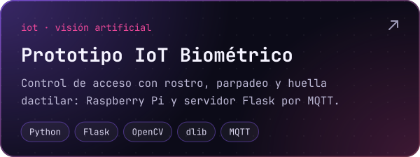</a>
  <a href="https://github.com/MariaDSalazar/soundmind">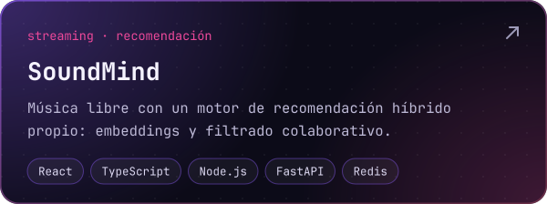</a>

  <a href="https://github.com/MariaDSalazar/officego">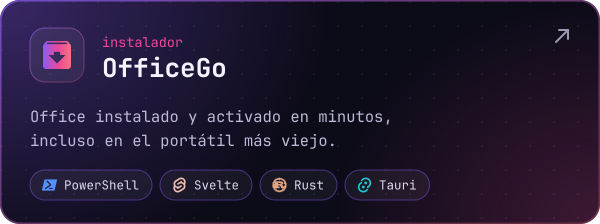</a>
  <a href="https://github.com/MariaDSalazar/Portafolio">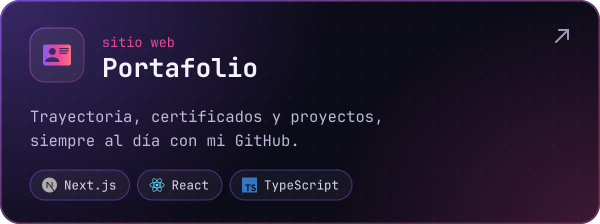</a>

  <a href="https://github.com/MariaDSalazar/SciFinder">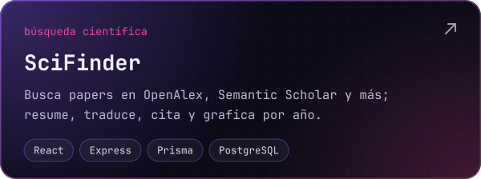</a>
  <a href="https://github.com/MariaDSalazar/gestor-bibliografico">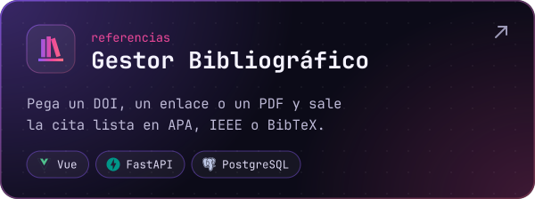</a>

### `~/software-educativo`

Juegos y simuladores que mis estudiantes abren en el navegador, sin instalar nada.

  <a href="https://mariadsalazar.github.io/kinti-bus/">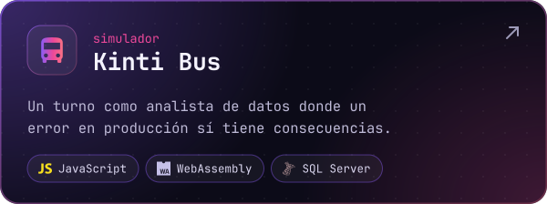</a>
  <a href="https://mariadsalazar.github.io/gorush/">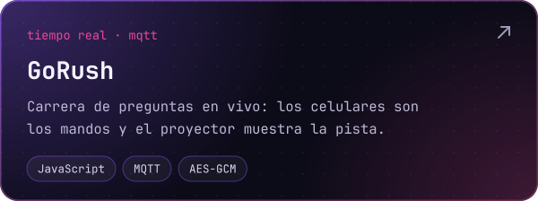</a>

  <a href="https://mariadsalazar.github.io/super-campus/">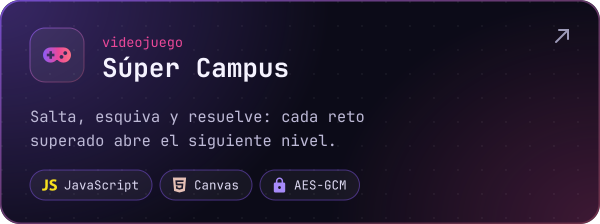</a>
  <a href="https://mariadsalazar.github.io/gopher-laberinto-interfaces/">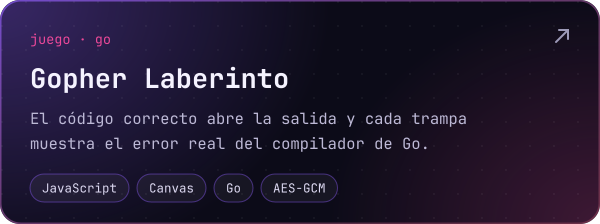</a>

  <a href="https://github.com/search?q=user%3AMariaDSalazar+topic%3Aeducacion&type=repositories">Ver todo el software educativo</a>

### `~/stack`

  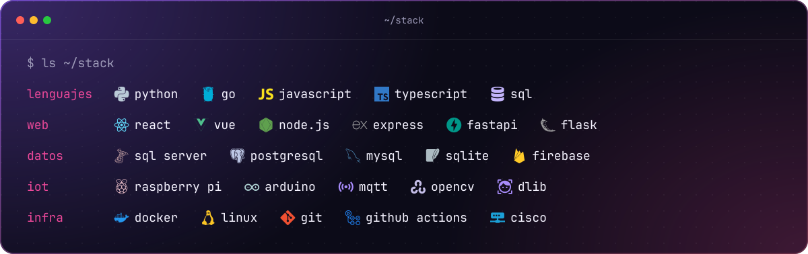

  <a href="https://mariadsalazar.github.io/Portafolio/">Portafolio</a> ·
  <a href="https://www.linkedin.com/in/mariasalazar24">LinkedIn</a>

